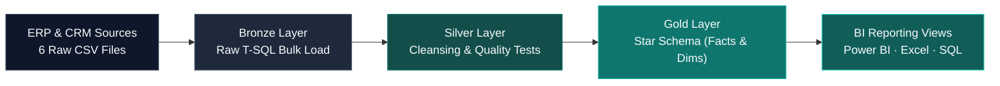

&lt;div align=&quot;center&quot;&gt;

&lt;img width=&quot;100%&quot; src=&quot;https://capsule-render.vercel.app/api?type=soft&amp;color=0:0F172A,100:115E59&amp;height=145&amp;section=header&amp;text=Galib%20Hasan&amp;fontSize=42&amp;fontColor=F8FAFC&amp;fontAlignY=42&amp;desc=Data%20Analyst%20%C2%B7%20SQL%20Data%20Warehousing%20%C2%B7%20Analytics%20Engineering&amp;descSize=15&amp;descColor=CBD5E1&amp;descAlignY=70&quot; alt=&quot;Galib Hasan — Data Analyst &amp; Analytics Engineering&quot; /&gt;

&lt;br /&gt;

*Turning raw operational datasets into validated warehouses, reproducible KPI pipelines, and decision-ready BI.*

&lt;p&gt;
&lt;a href=&quot;https://galibhasan.vercel.app&quot;&gt;&lt;img src=&quot;https://img.shields.io/badge/Portfolio-galibhasan.vercel.app-0F172A?style=for-the-badge&amp;logo=vercel&amp;logoColor=white&quot; alt=&quot;Portfolio&quot; /&gt;&lt;/a&gt;
&lt;a href=&quot;https://www.google.com/search?q=https://galibhasan.vercel.app/Galib\_Hasan\_Data\_Analyst\_Resume.pdf&quot;&gt;&lt;img src=&quot;https://img.shields.io/badge/Resume-PDF-0F766E?style=for-the-badge&amp;logo=adobeacrobatreader&amp;logoColor=white&quot; alt=&quot;Resume&quot; /&gt;&lt;/a&gt;
&lt;a href=&quot;https://www.google.com/search?q=https://www.linkedin.com/in/galibhasan00&quot;&gt;&lt;img src=&quot;https://img.shields.io/badge/LinkedIn-Connect-0A66C2?style=for-the-badge&amp;logo=linkedin&amp;logoColor=white&quot; alt=&quot;LinkedIn&quot; /&gt;&lt;/a&gt;
&lt;a href=&quot;mailto:galibhasan720@gmail.com&quot;&gt;&lt;img src=&quot;https://img.shields.io/badge/Email-Contact-334155?style=for-the-badge&amp;logo=gmail&amp;logoColor=white&quot; alt=&quot;Email&quot; /&gt;&lt;/a&gt;
&lt;/p&gt;

&lt;sub&gt;BSc CS @ Independent University, Bangladesh (IUB '27) · Minor in Big Data & HPC · Dhaka (UTC+6) · Open to Data Analyst, BI & Analytics Engineering roles&lt;/sub&gt;

&lt;/div&gt;

&lt;br /&gt;

&lt;div align=&quot;center&quot;&gt;

| **3 Layers** | **6 Sources** | **14 Scripts** | **2 Gold Views** |
| ----- | ----- | ----- | ----- |
| Bronze → Silver → Gold ETL | ERP & CRM CSV Ingestion | Ordered T-SQL KPI Workflow | `report_customers` · `report_products` |

&lt;/div&gt;

&lt;br /&gt;

### End-to-End Analytics Architecture

&lt;br /&gt;

### Featured Work

#### Data Warehousing & SQL Analytics

&lt;table&gt;
&lt;tr&gt;
&lt;td width=&quot;50%&quot; valign=&quot;top&quot;&gt;
&lt;strong&gt;&lt;a href=&quot;https://www.google.com/search?q=https://github.com/galibhasan720/sql-data-warehouse-project-dwh&quot;&gt;SQL Data Warehouse (DWH)&lt;/a&gt;&lt;/strong&gt;&lt;br /&gt;
&lt;sub&gt;End-to-End Medallion ETL &amp; Star Schema&lt;/sub&gt;&lt;br /&gt;&lt;br /&gt;
3-layer SQL Server warehouse (&lt;code&gt;Bronze → Silver → Gold&lt;/code&gt;) ingesting 6 ERP &amp; CRM CSV sources via automated stored procedures, Fact/Dimension modeling, SQL quality tests, and data catalog docs.&lt;br /&gt;&lt;br /&gt;
&lt;code&gt;SQL Server&lt;/code&gt; &lt;code&gt;T-SQL&lt;/code&gt; &lt;code&gt;Stored Procedures&lt;/code&gt; &lt;code&gt;Star Schema&lt;/code&gt;
&lt;/td&gt;
&lt;td width=&quot;50%&quot; valign=&quot;top&quot;&gt;
&lt;strong&gt;&lt;a href=&quot;https://www.google.com/search?q=https://github.com/galibhasan720/advance-data-analysis&quot;&gt;Advanced SQL Data Analysis&lt;/a&gt;&lt;/strong&gt;&lt;br /&gt;
&lt;sub&gt;14-Script Ordered T-SQL KPI &amp; Segmentation Workflow&lt;/sub&gt;&lt;br /&gt;&lt;br /&gt;
Structured analytics pipeline covering KPI exploration, ranking, time-series, cumulative &amp; YoY performance (CTEs + Window Functions), segmentation, and 2 reusable Gold BI views.&lt;br /&gt;&lt;br /&gt;
&lt;code&gt;T-SQL&lt;/code&gt; &lt;code&gt;CTEs&lt;/code&gt; &lt;code&gt;Window Functions&lt;/code&gt; &lt;code&gt;BI Views&lt;/code&gt;
&lt;/td&gt;
&lt;/tr&gt;
&lt;/table&gt;

#### High-Performance Computing & Full-Stack Systems

&lt;table&gt;
&lt;tr&gt;
&lt;td width=&quot;50%&quot; valign=&quot;top&quot;&gt;
&lt;strong&gt;&lt;a href=&quot;https://github.com/galibhasan720/Parallel-Log-Analysis&quot;&gt;Parallel Log Analysis&lt;/a&gt;&lt;/strong&gt;&lt;br /&gt;
&lt;sub&gt;Multi-Paradigm CPU-Parallel HPC Platform&lt;/sub&gt;&lt;br /&gt;&lt;br /&gt;
High-throughput log analytics with ProcessPool, dynamic scheduling, OpenMP &amp; single-node MPI backends, scaling benchmarks, and local LLM (Ollama) aggregate explanations.&lt;br /&gt;&lt;br /&gt;
&lt;code&gt;Python&lt;/code&gt; &lt;code&gt;C&lt;/code&gt; &lt;code&gt;OpenMP&lt;/code&gt; &lt;code&gt;MPI&lt;/code&gt; &lt;code&gt;FastAPI&lt;/code&gt; &lt;code&gt;React&lt;/code&gt;
&lt;/td&gt;
&lt;td width=&quot;50%&quot; valign=&quot;top&quot;&gt;
&lt;strong&gt;&lt;a href=&quot;https://github.com/galibhasan720/Seat-Flow&quot;&gt;SeatFlow&lt;/a&gt;&lt;/strong&gt; · &lt;a href=&quot;https://seat-flow-beta.vercel.app&quot;&gt;Live&lt;/a&gt;&lt;br /&gt;
&lt;sub&gt;Event Seat Booking &amp; Management System&lt;/sub&gt;&lt;br /&gt;&lt;br /&gt;
Containerized FastAPI service backed by a relational PostgreSQL schema on Supabase with JWT-authenticated customer and organizer workflows.&lt;br /&gt;&lt;br /&gt;
&lt;code&gt;TypeScript&lt;/code&gt; &lt;code&gt;React&lt;/code&gt; &lt;code&gt;FastAPI&lt;/code&gt; &lt;code&gt;PostgreSQL&lt;/code&gt; &lt;code&gt;Docker&lt;/code&gt;
&lt;/td&gt;
&lt;/tr&gt;
&lt;tr&gt;
&lt;td width=&quot;50%&quot; valign=&quot;top&quot;&gt;
&lt;strong&gt;&lt;a href=&quot;https://www.google.com/search?q=https://github.com/galibhasan720/AI-Integrated-TCMS&quot;&gt;AI-Integrated TCMS&lt;/a&gt;&lt;/strong&gt; · &lt;a href=&quot;https://www.google.com/search?q=https://github.com/galibhasan720/Tortoise-Conservation-Management-System&quot;&gt;Base&lt;/a&gt;&lt;br /&gt;
&lt;sub&gt;Role-Based Operations &amp; Audit Platform&lt;/sub&gt;&lt;br /&gt;&lt;br /&gt;
8-role RBAC management platform with CSRF-protected PDO/MySQL CRUD, rollback-safe runtime health probes, and timestamped JSON audit exports.&lt;br /&gt;&lt;br /&gt;
&lt;code&gt;PHP 8&lt;/code&gt; &lt;code&gt;MySQL&lt;/code&gt; &lt;code&gt;PDO&lt;/code&gt; &lt;code&gt;JavaScript&lt;/code&gt; &lt;code&gt;Bootstrap 5&lt;/code&gt;
&lt;/td&gt;
&lt;td width=&quot;50%&quot; valign=&quot;top&quot;&gt;
&lt;strong&gt;&lt;a href=&quot;https://www.google.com/search?q=https://github.com/galibhasan720/galib-hasan-portfolio&quot;&gt;Editorial Portfolio&lt;/a&gt;&lt;/strong&gt; · &lt;a href=&quot;https://galibhasan.vercel.app&quot;&gt;Live&lt;/a&gt;&lt;br /&gt;
&lt;sub&gt;Swiss Editorial Technical Monograph&lt;/sub&gt;&lt;br /&gt;&lt;br /&gt;
Interactive Next.js 15 portfolio featuring a Medallion Architecture Inspector (&lt;code&gt;Fig. 2.1&lt;/code&gt;) and 14-Script T-SQL Workflow Explorer (&lt;code&gt;Fig. 2.2&lt;/code&gt;).&lt;br /&gt;&lt;br /&gt;
&lt;code&gt;Next.js 15&lt;/code&gt; &lt;code&gt;TypeScript&lt;/code&gt; &lt;code&gt;Tailwind CSS&lt;/code&gt; &lt;code&gt;Vercel&lt;/code&gt;
&lt;/td&gt;
&lt;/tr&gt;
&lt;/table&gt;

&lt;br /&gt;

### Technical Stack

&lt;div align=&quot;center&quot;&gt;
&lt;img src=&quot;https://skillicons.dev/icons?i=py,ts,postgres,mysql,fastapi,react,nextjs,docker,git,c&amp;perline=10&quot; alt=&quot;Core Technologies&quot; /&gt;
&lt;/div&gt;

&lt;br /&gt;

| Focus Area | Tools & Methods |
| ----- | ----- |
| **SQL & Warehousing** | SQL Server · T-SQL · PostgreSQL · MySQL · Medallion ETL · Star Schema · Stored Procedures · Data Quality Testing |
| **Analytics & BI** | EDA · KPI Modeling · YoY & Cumulative Analysis · Segmentation · Power BI · DAX · Excel |
| **Computing & Systems** | Python (`pandas`, multiprocessing) · C (`OpenMP`, `MPI`) · FastAPI · Next.js · Docker · Git |

&lt;br /&gt;

### GitHub Analytics

&lt;div align=&quot;center&quot;&gt;
&lt;img height=&quot;150&quot; src=&quot;https://github-readme-stats.vercel.app/api?username=galibhasan720&amp;show_icons=true&amp;hide_border=true&amp;bg_color=00000000&amp;title_color=0F766E&amp;icon_color=14B8A6&amp;text_color=64748B&amp;rank_icon=github&quot; alt=&quot;Galib Hasan GitHub Stats&quot; /&gt;
&lt;img height=&quot;150&quot; src=&quot;https://github-readme-stats.vercel.app/api/top-langs/?username=galibhasan720&amp;layout=compact&amp;hide_border=true&amp;bg_color=00000000&amp;title_color=0F766E&amp;text_color=64748B&amp;langs_count=6&quot; alt=&quot;Top Languages&quot; /&gt;
&lt;/div&gt;

&lt;details&gt;
&lt;summary&gt;&lt;sub&gt;&lt;strong&gt;View Contribution Activity Graph&lt;/strong&gt;&lt;/sub&gt;&lt;/summary&gt;
&lt;br /&gt;
&lt;div align=&quot;center&quot;&gt;
&lt;img width=&quot;95%&quot; src=&quot;https://github-readme-activity-graph.vercel.app/graph?username=galibhasan720&amp;bg_color=00000000&amp;color=64748B&amp;line=0F766E&amp;point=14B8A6&amp;area=true&amp;hide_border=true&amp;height=260&quot; alt=&quot;Galib Hasan Contribution Activity Graph&quot; /&gt;
&lt;/div&gt;
&lt;/details&gt;

&lt;br /&gt;

&lt;div align=&quot;center&quot;&gt;
&lt;sub&gt;
Workflow: &lt;code&gt;Ask → Clean → Analyze → Report&lt;/code&gt; ·
&lt;a href=&quot;https://galibhasan.vercel.app&quot;&gt;Portfolio&lt;/a&gt; ·
&lt;a href=&quot;https://www.google.com/search?q=https://galibhasan.vercel.app/Galib\_Hasan\_Data\_Analyst\_Resume.pdf&quot;&gt;Resume&lt;/a&gt; ·
&lt;a href=&quot;https://www.google.com/search?q=https://www.linkedin.com/in/galibhasan00&quot;&gt;LinkedIn&lt;/a&gt; ·
&lt;a href=&quot;mailto:galibhasan720@gmail.com&quot;&gt;galibhasan720@gmail.com&lt;/a&gt;
&lt;/sub&gt;
&lt;/div&gt;
